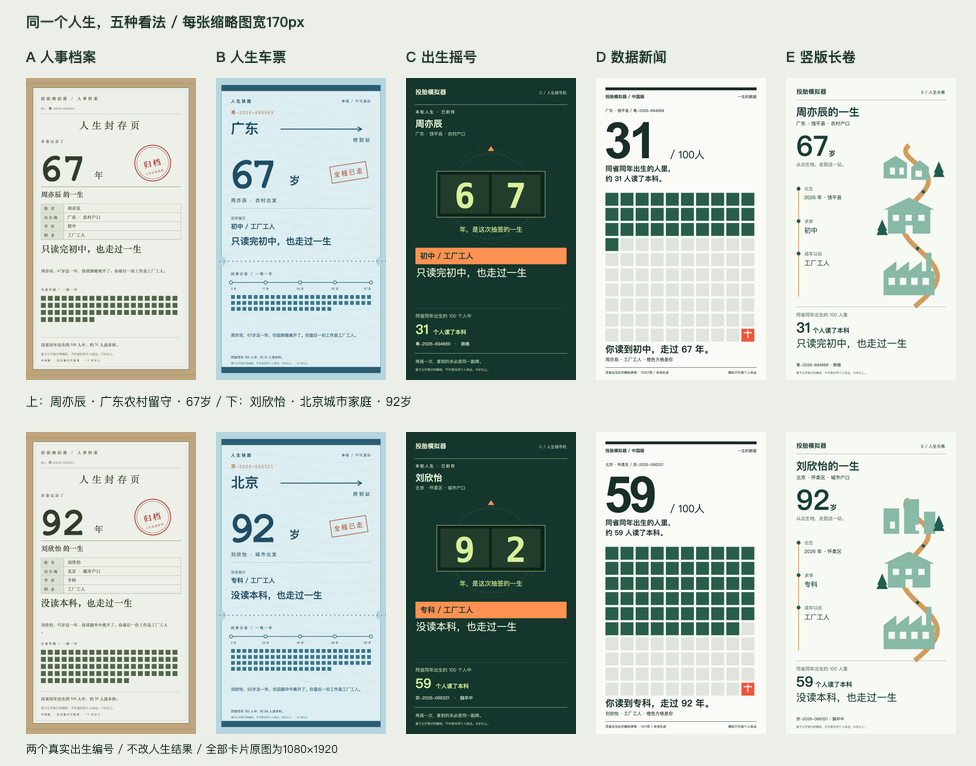

# 03 视觉探索交付

本阶段完成五种视觉方向，供选定后进入 04。未部署，未迁移到正式 `src/ui/`。

运行 `npm run lab`，打开 <http://127.0.0.1:5174/>。入口可切换两个真实人生，各方案可切换出生、15岁裁决、终局卡，以及375手机／1280桌面。

## 五个方向

| 方案 | 设计意图 | 风险与下一步 |
| --- | --- | --- |
| A 人事档案 | 牛皮纸外套、人口登记栏目、等宽编号与归档章，让人生成为一份逐年填满的档案。 | 格线与细节较密；正式落地时需要照顾较长日志和大字号阅读。 |
| B 人生车票 | 冰蓝票面、始发／换乘／终到、经停站与同车旅客，把人生路径变成一张票。 | 铁路隐喻很强，未来多次转行与回流需要设计更丰富的经停表达。 |
| C 出生摇号 | 墨绿机身、信号绿计数器、橙色结果条与球形同龄人；真实编号与省份短暂滚动后停住。 | 唯一深色方向；动画只揭晓固定真实结果，不制造新抽样，支持减少动态效果设置；完整转轮交互仍需随正式流程打磨。 |
| D 数据新闻 | 白底强网格、朱红主人公、100人点阵与超大数字，让个人经历与群体分布同屏。 | 点阵容易被误读成现实调查，卡片注明模拟，出处页解释分母与样本；正式版需延展节点间点阵变化。 |
| E 竖版长卷 | 浅薄荷底、竖向道路与剪纸几何建筑，沿村庄／城市、校园、工厂向下展开。 | 情绪和叙事强，长人生还需要更多职业与地域场景；当前几何场景按真实城乡和工作选择。 |

推荐 **D 数据新闻**：在170px缩略图里，点阵和大数字最容易传达核心信息，也最适合分享。仅作参考，最终方向由用户选择。

四个浅色方向，一个墨绿深色方向。无渐变、毛玻璃、柔和大阴影、emoji、发光或像素场景。A使用档案纸和公章，但不采用原作「米色纸＋酒红＋横版像素」组合。

## 真数据与交付文件

| 编号 | 人生 | 15岁真实裁决 | 最终学历／退休前工作 | 寿命 | 同省参考队列折算100人读本科 |
| --- | --- | --- | --- | --- | --- |
| 京-2026-066321 | 刘欣怡，北京怀柔区，城市富裕家庭 | 普通高中已录取 | 专科／工厂工人 | 92岁 | 59人 |
| 粤-2026-694669 | 周亦辰，广东饶平县，农村收入紧张家庭，父母外出、祖辈照护 | 普通高中已录取 | 初中／工厂工人 | 67岁 | 31人 |

数据由 `design-lab/export-data.mjs` 调用现有引擎，以默认自动选择完整运行这两个编号，再生成 `data.json`。中段四个同秒出生人物沿用正式界面的派生种子公式。两局15岁都录取普通高中，未为了视觉效果虚构未录取章；周亦辰18岁普通高中高三未完成。

五个目录均含 `index.html`、`theme.css`、`card.mjs`、`card.png`。`card.png`默认是农村留守样本；另有两局各自的 `card-rural.png`、`card-urban.png`、SVG及170px缩略图。共10张PNG原图，每张1080×1920；终局页面使用同源SVG，提供PNG下载。

`npm run lab:export` 可重跑真数据和导出。导出脚本使用本机Chrome与Codex附带的Playwright、Sharp；可用 `TOUTAI_RENDER_NODE_MODULES` 指定依赖目录。本地浏览和现有PNG无需这些导出依赖。

## 170px缩略图对比

每列一个方案，上排周亦辰、下排刘欣怡；每张卡片实际宽170px。主数字与核心句已按此尺寸逐张检查；细节正文需打开原图阅读。

## 字体与License

仅使用系统字体栈：中文黑体为 PingFang SC／Microsoft YaHei／Heiti SC；宋体为 Songti SC／STSong／SimSun；等宽为 Menlo／Courier New／monospace。实际字体取决于操作系统，Windows与macOS字形、换行可能略有差异。

没有下载、打包或嵌入任何字体文件，没有Google Fonts、境外CDN或远程字体请求，因此本交付不涉及第三方字体文件的再分发和网页嵌入授权。系统字体由用户系统提供，不将其宣称为开源字体。导出PNG已固化当前机器的排版。

## 四项文案小修

| 项目 | 修改前 | 修改后／规则 |
| --- | --- | --- |
| 父母职业自然句式 | 爸爸周建华当时32岁，做外出务工者。 | 爸爸周建华当时32岁，在外地打工。职业名词映射为动词短语；不凭空补店铺、医院或地名。 |
| 内部参数脚注 | 35岁事件附「本次人生计算中……风险为14%，来源：本地岗位风险参数……」。 | 35岁事件正文保留，脚注为空。`visibleFootnote`只接受统计引用，且只有底表status为已核或待核才显示；直接附在事件上的参数解释不渲染。 |
| 免责尾巴 | 统计后逐条重复历史资料、平均指标不决定个人命运等解释。 | 例如「2024 年普高招生数约为初中毕业生的61%。来源：第一财经按教育事业发展统计公报人数计算。」统一说明收进实验室「统计出处与说明」页。未列明调查年份的旧资料仍明确写明，不编造年份。 |
| 明确辍学阶段 | 这一段学业没能完成。 | 周亦辰实际日志：「普通高中高三没读完，你提前离开了学校。你要分担家里的开销，能留在学校的时间越来越少，这一段学业没能完成。」中职路径相应写明「中职三年级没读完」。不虚构去了东莞。 |

修改限于 `src/content/` 与相关测试。新脚注展示函数已接入design-lab的数据导出；正式旧UI仍沿用原展示代码，04迁移时须接入此函数与统一出处说明页，本阶段未越界修改 `src/ui/`。

## 验证

- `npm test`：28项全部通过，包括2000局真实日志扫描、职业自然句式、明确辍学阶段、统计脚注状态过滤；未改校准目标或引擎测试标准。
- `npm run calibrate`：十万人、25项全部PASS，两条努力边界仍PASS；完整JSON与02阶段开始时保存的基线逐字一致。普高61.700%、队列本科34.542%、城市最高家境本科66.967%、农村最低家境本科9.618%、学习增益12.437pp、城市富裕自动减农村困难全学习52.532pp、硕士7.610%、体制内5.606%、40岁骑手与网约车0.530%、农村出身务农15.714%。
- `npm run build`：通过。
- 浏览器检查：5方案×2人生×3屏×2尺寸，共60张截图；375×812手机、1280×900桌面。60/60无横向溢出，手机出生主按钮、裁决区和同秒四人均在812px内；运行错误0、外部网络请求0。终局竖卡保留9:16，桌面允许正常纵向滚动。
- `design-lab/qa-results.json` 保存尺寸检查与切换结果，`design-lab/screenshots/`保存全部60张截图；`qa-birth.png`、`qa-mid.png`便于并排核看。上述自动尺寸检查之外，人工查看出生、中段拼图与终局缩略图。
- 10张终局PNG导出时均检查1080×1920；对比图 `design-lab/thumbs.png` 为976×766，卡片本身170×302。
- 开工前后校验：`src/engine/`、`data/cn-stats.json`及原有docs文件哈希未变；校准参考队列与结果文件内容也未变。只新增本results文档。

## 数据疑问

未发现需要改动底表的新问题。31／59是本地模拟参考队列折算人数，不能解释为这两个个体真实同学的升学率；已在出处说明中明确。
