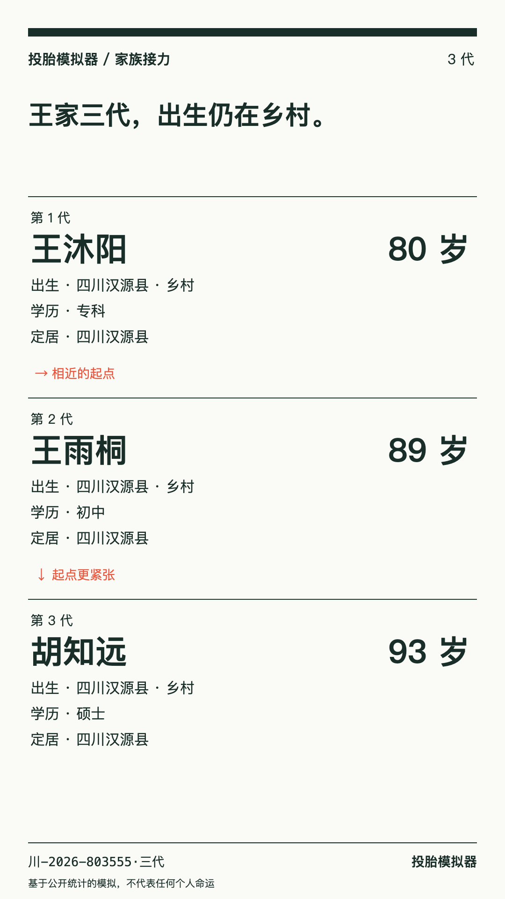

# 06 家族城乡、成就与骰子标签修正

已完成06及本轮补充的生育修正。未部署；本地入口 <http://127.0.0.1:5186/>。data只读，旧docs未改。

## 家族出生规则与生育

工作定居地与孩子出生户口分开。农村父代非本科、无城市住房时，低收入组有72%回老家出生，其他收入组58%；本科或有城市住房者90%随定居城市出生，本科且有城市住房者96%。父母仍在城市工作、孩子在农村出生时，留守概率68%。城市出身沿用原规则。收入分位使用全国模拟队列的峰值劳动收入，避免退休后的养老金把所有家庭误判为低收入。上述值集中放在params.js，status=参数，是产品目标参数，非现实统计。

出生地选择使用独立的确定性家族随机流；不消耗父代随机状态。父母姓名和职业保留，外出标记与工作地驱动02原有留守事件；新增三条前代留守、下一代再次留守的回环。孩子取父亲的姓，女性玩家的孩子取配偶姓。

「走出村子」现按三代中是否有人**以城市户口出生**判定，不再因玩家到县城工作就达成。终局已结束且未达成时明确显示未达成。家族卡标题同样按出生户口表达，第一代姓氏作为家族标题，允许后代随父姓变化。

经本轮明确授权，仅把生育自动选择概率从55%改为95%；婚姻、城市、教育等自动策略不动，手动选择仍可不生育。

### 新断言实测

固定5000个第一代出生；城乡派生仅统计有孩子、能接力的终局。各比例是游戏模拟，不是社会调查。

| 指标 | 分子／分母 | 实测 | 目标 |
| --- | --- | --- | --- |
| 农村、非本科、未买房 → 孩子农村 | 853／1177 | 72.472% | ≥50%，PASS |
| 上述农村孩子中留守 | 566／853 | 66.354% | ≥30%，PASS |
| 本科且有城市住房 → 孩子城市 | 312／328 | 95.122% | ≥70%，PASS |
| 1000个可接力农村Q1家族三代内城市出生 | 520／1000 | 52.000% | 30–80%，PASS |
| 活到45岁者至少一个孩子 | 3627／4864 | 74.568% | 65–85%，PASS |

本科购房组为配对干预检验：自动策略始终租房，无法自然给出该分层；对同批实际农村本科终局保持其余条件不变，设置已在城市购房后派生孩子。此表检验派生规则，不把该组数量当成实际购房率。

按用户确认，30–80%断言的分母只含第一代有孩子、能接力的家族。为了得到1000个合资格家族，共抽到1368个农村Q1开局：含全部开局时为520／1368，38.012%，仅作参考。独立取前1000个全部开局时为388／1000，38.800%。未排除无孩子开局来冒充全体达成率。

有孩子者的平均孩子数：3679／3679 = 1.000；45岁存活父母中同样为1.000。**当前模型最多一个孩子**，本轮提高的是有孩子的家庭占比，未扩展多孩分布；不能把1.000解释成现实中有孩家庭的平均生育数。

### 二、三代新分布

| 出生项 | 二代（n=3679） | 三代（n=2652） |
| --- | --- | --- |
| 农村户口 | 886（24.083%） | 378（14.253%） |
| 城市户口 | 2793（75.917%） | 2274（85.747%） |
| 留守 | 586（15.928%） | 270（10.181%） |
| 家境Q1 | 1010 | 743 |
| 家境Q2 | 880 | 626 |
| 家境Q3 | 804 | 595 |
| 家境Q4 | 641 | 444 |
| 家境Q5 | 344 | 244 |

[探针完整JSON](../tests/artifacts-06/family-probe.json)；复跑：`node scripts/probe-family-06.mjs`。

### 留守再留守样例原文

- 第1代：王沐阳，川-2026-803555，四川汉源县，农村，家境Q2，留守童年，专科，80岁；工作定居四川汉源县。
- 第2代：王雨桐，川-2026-803555·二代，四川汉源县，农村，家境Q2，留守童年，初中，89岁；工作定居四川汉源县。
- 第3代：胡知远，川-2026-803555·三代，四川汉源县，农村，家境Q1，非留守童年，硕士，93岁；工作定居四川汉源县。

二代出生原文：

> 2059年6月，你出生在四川汉源县的一个村子，名字叫王雨桐。你出生时，爸爸王沐阳当时33岁，经营自己的小生意；妈妈杨思源当时33岁，在工厂上班。那时家里的收入不宽裕，大笔支出都要提前攒钱。父母当时为了工作常年离家，你小时候主要跟着爷爷奶奶生活。

三条代际回环：

- 3岁：爸爸王沐阳小时候也常等父母过年回来。如今你在电话这头问，什么时候才能见到爸爸。
- 7岁：爸爸王沐阳记得小时候等电话的心情。视频快挂断时，你又问了一次下一次回家的日子。
- 11岁：爸爸王沐阳小时候把想说的话攒到过年。现在，你也把学校的事记在本子上，等爸爸回家。

二代实际触发的02旧留守事件（节选）：

- 2岁：爸爸妈妈把行李带回来，你先认了很久，才肯让他们抱。
- 4岁：奶奶把全家福放在床头，父母常年在外工作，你只能隔着电话听他们说晚安。
- 7岁：爷爷用摩托车载你去镇上，出门前把你的头盔带子扣了又扣。
- 8岁：过年见到父母，你攒了很久的话反而说不出来，只把手伸过去。
- 9岁：老师让家长签字，奶奶戴上眼镜，把父母的电话又写了一遍。
- 15岁：父母在外地宿舍接起视频，你把这次试卷举高，怕他们看不清。

PNG实测1080×1920，无网址。第三代随其父姓胡，第一代姓王只用于家族标题，未为保持姓氏连续而强行随母姓。

## 30个成就

全部名字≤8字符，下一行列出条件。仅5个标为入门，其余25个都低于10%；其中10个低于1%。采样策略保持05原样，未通过改样本策略凑稀有度：固定种子100000个第一代出生：70%默认自动、10%落榜时复读、10%有机会时尝试买房、10%每年学习；其余抉择自动，单局终局评价。

| 名字 | 条件 | 10万次模拟出现次数 | 比例 | 分层 |
| --- | --- | --- | --- | --- |
| 农村出身上本科 | 农村低收入家庭出生，最终获得本科及以上学历。 | 1302 | 1.302% | 成就 |
| 留守儿童上985 | 童年留守，最终学历为985本科。 | 74 | 0.074% | 稀有 |
| 复读一年上985 | 高考复读一年，最终学历为985本科。 | 50 | 0.050% | 稀有 |
| 第三次招录上岸 | 第三次参加公务员或事业单位招录考试时获录用。 | 980 | 0.980% | 稀有 |
| 只差1%未通过 | 一次正向裁决未通过，与通过门槛相差不足1个百分点。 | 6139 | 6.139% | 成就 |
| 北京长大读专科 | 北京城市户口出生，最终学历为专科。 | 162 | 0.162% | 稀有 |
| 活到100岁 | 这一生达到100岁。 | 3403 | 3.403% | 成就 |
| 一生都住在老家 | 终局仍在老家，从未选择迁往县城、省会或一线城市。 | 1034 | 1.034% | 成就 |
| 读到硕士毕业 | 最终完成硕士学业。 | 8287 | 8.287% | 成就 |
| 进入体制内岗位 | 35岁前进入公务员、事业编、教师或医护岗位。 | 5713 | 5.713% | 成就 |
| 农村留守读硕士 | 农村出生、童年留守，最终完成硕士学业。 | 859 | 0.859% | 稀有 |
| 留守儿童读本科 | 童年留守，最终获得本科及以上学历。 | 4006 | 4.006% | 成就 |
| 留守儿童当教师 | 童年留守，在40岁时从事教师工作。 | 218 | 0.218% | 稀有 |
| 留守儿童做医护 | 童年留守，在40岁时从事医护工作。 | 215 | 0.215% | 稀有 |
| 农村出身当技工 | 农村出生，在40岁时从事技术员工作。 | 4908 | 4.908% | 成就 |
| 留守后做个体户 | 童年留守，在40岁时经营个体生意。 | 1603 | 1.603% | 成就 |
| 农村出身当老板 | 农村低收入家庭出生，在40岁时经营自己的公司。 | 224 | 0.224% | 稀有 |
| 付下住房首付款 | 积蓄支持你付下住房首付。 | 72 | 0.072% | 稀有 |
| 成为孩子的父母 | 这一生迎接了孩子。 | 72927 | 72.927% | 入门 |
| 结婚组建家庭 | 这一生与伴侣结婚。 | 76937 | 76.937% | 入门 |
| 留守后定居城市 | 童年留守，后来选择在省会或一线城市生活。 | 3739 | 3.739% | 成就 |
| 净资产达百万 | 终局净资产达到100万元。 | 1541 | 1.541% | 成就 |
| 活到80岁 | 这一生达到80岁。 | 55555 | 55.555% | 入门 |
| 留守儿童读专科 | 童年留守，最终学历为专科。 | 5005 | 5.005% | 成就 |
| 留守后专升本科 | 童年留守，专科后选择继续升学，并最终获得本科及以上学历。 | 410 | 0.410% | 稀有 |
| 首次考研读硕士 | 第一次考研被录取，最终完成硕士学业。 | 4923 | 4.923% | 成就 |
| 首次招录就上岸 | 第一次参加公务员或事业单位招录考试即获录用。 | 2009 | 2.009% | 成就 |
| 留守后考上高中 | 童年留守，中考获得普通高中录取。 | 7971 | 7.971% | 成就 |
| 完成高中学业 | 完成普通高中或中职学业。 | 74399 | 74.399% | 入门 |
| 获得本科学历 | 最终获得本科及以上学历。 | 37277 | 37.277% | 入门 |

界面保留「10万次模拟里出现X次」，展示策略口径，不写成真实统计。成就不涉及死因、疾病或嘲讽。招录成就读取实际录用骰子事件，防止三次落榜后以其他途径就业被误记为第三次上岸。父母学历只有大类，无法可靠判定父母是否本科，未编造「家里首个大学生」。

旧图鉴迁移到版本2：保留省份、出身、学历、职业及寿命足迹；收紧条件的旧成就不直接继承为新稀有成就，保留条件未变的解锁项，当前存档终局可重新评价。导入导出与迁移均有测试。

频率文件：`src/content/achievements-rarity.json`；引擎／内容版本哈希：`c8b37c06e75b3ab50161cf366852adb3ec9b9592bc25d434916250d36baec293`。

## 骰子标签统计

固定seed0–2999、3000个自动人生，18784次骰子；标签可在同一骰子中出现多项，以下分母是展示因素次数。

| 标签 | 次数 |
| --- | --- |
| 家境 | 7693 |
| 城乡 | 7391 |
| 省份 | 11929 |
| 成绩 | 10290 |
| 努力 | 1594 |
| 学历 | 469 |
| 行业 | 2038 |

只有上述七类。内部cap和未知审计项不冒充玩家因素，原p/u和审计贡献仍保留。18784次判定、只差／险过边界、贡献方向及排序全PASS，概率重建最大误差2.7755575615628914e-17。这次样本与此前独立18562次探针的种子／策略不同，不混用次数。

[骰子探针JSON](../tests/artifacts-06/dice-probe.json)；复跑：`node scripts/probe-dice-06.mjs`。

## 校准与快照diff

`npm run calibrate`已重跑100000局，25项全部PASS，**完整JSON仍与03逐字一致**。快照changedFields=[]，没有字段变化，没有重建或覆盖03快照。教育、出生分布、5岁前死亡等25岁前指标均原样；另有2000局逐步状态／日志／rngState与旧生育自动策略的25岁前配对比较。

生育选项本来已有保留抽样，选生育与不生育的分支未追加随机数；本次修改没有造成这25项校准输出的变化。资产、生活日志和是否有孩子会变化，生育指标用独立新断言覆盖。

[逐字段快照比较JSON](../tests/artifacts-06/calibration-diff.json)。原03快照保留：`tests/fixtures/calibration-03.json`。

## 界面与验证产物

| 页面 | 375手机 | 1280桌面 |
| --- | --- | --- |
| 成就图鉴 | [截图](../tests/artifacts-06/dex-375.png) | [截图](../tests/artifacts-06/dex-1280.png) |
| 农村留守二代出生 | [截图](../tests/artifacts-06/left-birth-375.png) | [截图](../tests/artifacts-06/left-birth-1280.png) |
| 三代目标未达成 | [截图](../tests/artifacts-06/family-end-375.png) | [截图](../tests/artifacts-06/family-end-1280.png) |
| 七类骰子标签 | [截图](../tests/artifacts-06/dice-375.png) | [截图](../tests/artifacts-06/dice-1280.png) |

浏览器实测：30个成就名字长度、无横向溢出、县城工作不提前达成目标、留守农村出生、随父姓、接力刷新恢复、三代终局未达成提示。运行错误0。[UI检查JSON](../tests/artifacts-06/ui-result.json)。

### 最终验证结果

- `npm test`：50/50 PASS，包括十万人完整快照、原努力边界、2000局25岁前配对、家族及生育新阈值、成就频率／命名／禁词与旧图鉴迁移。
- `npm run calibrate`：25/25 PASS，完整输出与03快照逐字相同；diff无字段。
- `npm run build`：PASS；十万次成就文件与当前引擎哈希一致，开发与构建前都会核验。
- 375手机与1280桌面浏览器检查PASS，无横溢，运行错误0；家族PNG为1080×1920。
- data、旧docs、出生与基础RNG代码哈希不变。自动策略文件把新增P导入和生育阈值读取逆向还原后，与开工前SHA逐字匹配；没有改动其他自动策略。[保护文件检查](../tests/artifacts-06/protected-files.json)。
- docs仅新增本results，不部署。
