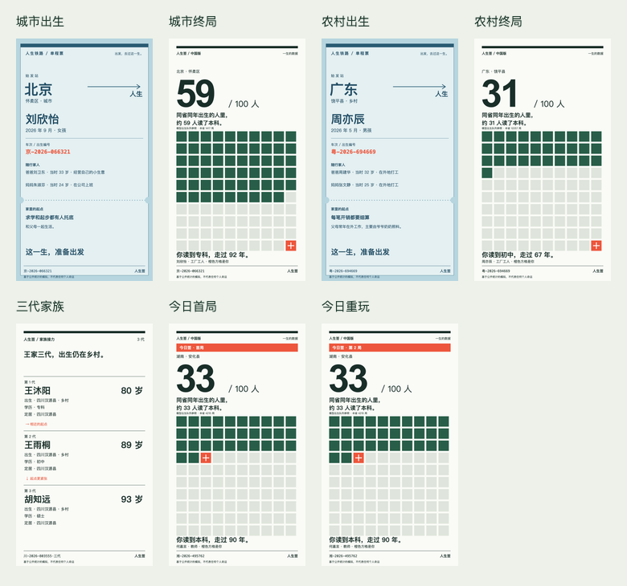

# 07 结果：人生签

已完成产品改名；首页主按钮为「出生 →」。本地目录和存储键保持原名，未部署。

## 文案范围

- `src/ui/App.jsx`：品牌、首页按钮、页脚、出生车票底部。
- `src/ui/share-cards.js`：出生、终局、三代家族分享卡的页眉页脚。
- `src/ui/ShareImage.jsx`：保存、下载兜底、系统分享共用「人生签-<编号>-<卡种>.png」文件名，系统分享标题为「人生签」。
- `src/ui/CollectionPage.jsx`：图鉴导出文件名为「人生签-人生图鉴.json」。
- `index.html`：页面标题为「人生签 · 中国版」。
- `tests/banned-words.js`：加入旧名禁词，使用 `\u6295\u80ce` 字符串转义，使运行时扫描真实旧词，同时满足源码 grep 清零。新增测试确认旧词命中、新名通过，并检查三类实际生成的分享卡文字。
- 历史 `tests/artifacts-04/05/06` 中的 SVG 仅替换旧品牌文字，保证指定 grep 范围清零；历史 PNG 截图按交接要求保留。

执行：

```sh
grep -rn 投胎 src index.html tests public
```

**标准输出为空，退出码 1（零匹配）**。记录见 [grep-result.json](../tests/artifacts-07/grep-result.json)。

## 验证

| 检查 | 结果 |
| --- | --- |
| `npm test` | **51/51 PASS**，0 失败、0 跳过 |
| 十万局完整校准快照测试 | **25 项全部 PASS，完整输出与 03 快照逐字一致**；测试重新运行出生队列与努力配对队列，并非只读取已有结果 |
| 努力边界两条 | PASS |
| 2000 局实际人生文本扫描 | PASS，包含新增旧名禁词 |
| `npm run build` | PASS，包含构建前图鉴哈希校验 |
| 375 / 1280 实际页面 | 标题、品牌、出生按钮正确；无横向溢出和页面异常 |
| 实际下载 | 两种宽度均获得「人生签-粤-2026-694669-出生.png」，1080×1920；兜底下载链接文件名相同 |
| 系统分享调用参数 | 浏览器中截获调用，标题「人生签」、文件名正确；此次未进行 iOS 真机复测 |
| 图鉴 JSON 下载 | 「人生签-人生图鉴.json」 |

测试完整输出见 [test-result.txt](../tests/artifacts-07/test-result.txt)，浏览器结果见 [ui-result.json](../tests/artifacts-07/ui-result.json)。页面截图：[375 首页](../tests/artifacts-07/home-375.png)、[1280 首页](../tests/artifacts-07/home-1280.png)、[375 出生卡](../tests/artifacts-07/birth-375.png)、[1280 出生卡](../tests/artifacts-07/birth-1280.png)。

三项 localStorage 键逐项比对未变：`toutai-sim:v2`、`toutai-sim:daily:v1`、`toutai-sim:collection:v1`。

## 分享样卡

七张样卡均重新导出 SVG、**1080×1920 PNG** 和 **170×302 缩略图**。已检查实际图片和缩略图对比图；SVG 全部文字的包围盒均在画布内，页眉页脚品牌无溢出。像素尺寸和边界记录见 [render-result.json](../tests/artifacts-07/render-result.json)。

| 样卡 | PNG 原图 |
| --- | --- |
| 城市出生 | [人生签-京-2026-066321-出生.png](../tests/artifacts-07/人生签-京-2026-066321-出生.png) |
| 城市终局 | [人生签-京-2026-066321-终局.png](../tests/artifacts-07/人生签-京-2026-066321-终局.png) |
| 农村出生 | [人生签-粤-2026-694669-出生.png](../tests/artifacts-07/人生签-粤-2026-694669-出生.png) |
| 农村终局 | [人生签-粤-2026-694669-终局.png](../tests/artifacts-07/人生签-粤-2026-694669-终局.png) |
| 三代家族 | [人生签-川-2026-803555·三代-家族.png](../tests/artifacts-07/人生签-川-2026-803555·三代-家族.png) |
| 今日首局 | [人生签-湘-2026-495762-今日签首局.png](../tests/artifacts-07/人生签-湘-2026-495762-今日签首局.png) |
| 今日重玩 | [人生签-湘-2026-495762-今日签第2局.png](../tests/artifacts-07/人生签-湘-2026-495762-今日签第2局.png) |

每日样卡使用上海日期 `2026-10-22` 的同一编号；首局印「首局」，第二局印「第 2 局」。缩略图同目录，文件名末尾为 `-170.png`。



可复现导出：`node scripts/render-share-07.mjs`。页面核对：启动 `npm run dev -- --port 5187` 后执行 `node scripts/check-ui-07.mjs`；两脚本使用本机已提供的 Chrome 和 Codex 依赖运行时。

## 经用户授权的派生产物刷新

开始时发现底表说明文字已被 Claude 改名，导致 06 图鉴记录的整体哈希过期，已有校验会阻止构建。用户说明底表数值未变，并授权仅重跑两个派生产物，前提是 30 个成就的十万次模拟计数逐项与 06 相同。

重跑先输出到临时文件，比较通过后才更新 `src/content/achievements-rarity.json` 和 `src/content/engine-version.js`。**30/30 个计数完全相同**，只刷新版本哈希；逐个 before/after 记录见 [rarity-comparison.json](../tests/artifacts-07/rarity-comparison.json)。

- 原记录哈希：`c8b37c06e75b3ab50161cf366852adb3ec9b9592bc25d434916250d36baec293`
- 当前哈希：`4b4224b5c9fcf3f0c07e4ccb13a49b3764989aaa8157c45022a6bd66d7bd9239`

与本轮开始时的逐文件 SHA-256 比对：引擎、内容模板、成就规则、`data/` 和既有 `docs/` 全部未变；受保护目录内只有上述两个经授权的派生产物变化。核对见 [protected-files.json](../tests/artifacts-07/protected-files.json)。`docs/` 本轮仅新增本结果文件。无部署操作。
