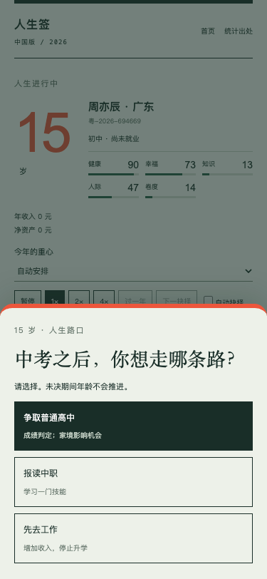

# 08 结果：手机抉择与人生节奏热修

已按 `docs/codex-handoff-08-hotfix-pacing.md` 完成热修，停在 08。未开始 v2，未部署。

## 改动

- 普通局自动抉择默认关闭。没有迁移标记的旧存档，无论原值 true / false，都迁移为 false；热修后由玩家主动开启的偏好可保存。
- 手机宽度 <768px 时，抉择通过 portal 显示为底部模态，带遮罩、`aria-modal="true"`、背景 inert、body/页面滚动锁定与焦点约束。选完释放滚动和背景交互；桌面仍在原位置显示。
- 自动抉择改为 10 秒；触摸、pointerdown 或卡片内部滚动会停止当前抉择的自动选择，显示「已停止自动选择，请自己选」。游戏暂停或页面 hidden 时暂停倒计时，返回后继续剩余秒数。
- 时长改为 15 / 30 / 60 分钟，默认 30。旧 5 / 10 / 20 分钟分别迁移到对应新档。
- 重要年份权重 2、日常年份权重 0.6。通过只读预测副本分配剩余观看预算，选择/重心改变后重新分配；实际人生仍逐步调用原引擎。1× 观看时间不包含暂停、玩家手动思考、骰子停留，页面已说明；2× / 4× 继续有效。
- 骰子揭晓后，普通局直到关闭弹层才恢复推进；UI reducer 也拒绝在弹层未关闭时推进。
- 出生卡加「重新抽签」，立刻更新身份与编号、不限次数；每日签、接力孩子隐藏按钮，分别说明「今日签全国同一个开局」「孩子的出身由上一代决定」。
- 出生预览和重抽不再计入图鉴，点击「开始这一生」后才记录。已存在的收藏保留。

实现：`src/ui/App.jsx`、`src/ui/preferences.js`、`src/ui/pacing.js`、`src/style.css`。没有更改引擎、人生模板或成就规则。

## 验证

| 检查 | 结果 |
| --- | --- |
| `npm test` | **55/55 PASS**，0 失败、0 跳过（原 51 项 + 新增 4 项） |
| 十万局 25 项校准 | **全部 PASS，完整输出与 03 快照逐字一致** |
| 15 / 30 / 60 分钟预算 | 30 局逐步执行通过；额外覆盖手动选择和途中切换重心 |
| `node scripts/check-ui-08.mjs` | **14 项 PASS**，页面错误 0 |
| `npm run build` | PASS，含图鉴频率哈希校验 |
| 375px 滚动回归 | **真实墙钟超过 15 秒**持续滚轮与模拟触摸滑动，不自动选、不推进 |
| 767 / 768 / 1280px | 模态断点正确，桌面原位，动态切换恢复滚动锁 |
| 自动抉择 | 10 秒、触摸停止、卡内滚动停止、暂停、hidden 后继续剩余秒数均通过 |
| 重抽 | 连续 12 次更换编号、图鉴不增长；开始后才记录；每日/接力例外通过 |
| 极速局 | 自动偏好关闭时仍在 60 秒完整终局，结果与原引擎一致 |

完整输出：[测试](../tests/artifacts-08/test-result.txt)、[浏览器](../tests/artifacts-08/ui-result.txt)、[浏览器结构化证据](../tests/artifacts-08/ui-result.json)、[构建](../tests/artifacts-08/build-result.txt)。

新增单元测试：`tests/hotfix-08.test.js`。浏览器复现：启动 `npm run dev -- --port 5188` 后执行 `node scripts/check-ui-08.mjs`；使用本机 Chrome 和已提供的 Playwright 运行时。

## 375px 手机抉择层

已打开实际生成的截图检查：底部卡片、暗色遮罩、三项按钮均在 375×812 视口内。

滚动前后均为：15 岁、待决 `school`、随机数状态 `337779872`、选择数 0、日志数 31；body overflow 为 hidden，遮罩和模态持续存在。实际墙钟秒数见浏览器证据。浏览器模拟验证，未做手机真机复测。

其他截图：[桌面原位抉择](../tests/artifacts-08/decision-inline-1280.png)、[出生卡重抽](../tests/artifacts-08/birth-reroll-375.png)、[30 分钟档终局](../tests/artifacts-08/end-30-minute-375.png)。

## 30 分钟档整局节奏实测

使用**浏览器虚拟时钟加速完整一局，不是实际挂机 30 分钟**。编号 `粤-2026-694669`，1×、自动抉择开启，67 岁终局：

- 年份观看时间：**1800 秒（30 分钟）**。
- 7 次自动抉择等待：70 秒；骰子揭晓动画：2.4 秒。
- 记录的整局时钟：**1872.504 秒，即 31 分 12.504 秒**，相对 30 分钟约 +4.03%，在 ±20% 内。
- 本局重要年份显示约 62.5 秒，日常年份约 18.75 秒，对应归一基准的 ×2 / ×0.6。
- 逐岁等待、抉择、骰子都走真实 UI；终局完整状态与同一浏览器运行的原引擎结果一致。逐年时长保存在浏览器 JSON 的 `delays` 中。
- 手动模式下玩家可以不限时停留；这部分不承诺总墙钟上限。

## 派生频率与只读范围

底表新增 v2 数据使整体哈希失效。按交接授权，先把十万局频率输出到临时文件，与 07 逐项比较，**30/30 个计数完全相同**后，才刷新 `src/content/achievements-rarity.json` 与 `src/content/engine-version.js`。对照：[rarity-comparison.json](../tests/artifacts-08/rarity-comparison.json)。

执行期间，外部又更新了 `data/cn-stats.json` 和两份 v2 文档。本轮未写入这些文件，保留外部改动，并基于最终底表重新跑了成就频率、完整测试、校准、构建及浏览器检查。最终验证期间文件哈希稳定，记录见 [revalidation-start.json](../tests/artifacts-08/revalidation-start.json)。

最终引擎哈希：`c6853ce214043586c06953bb8afee512edac4ad62ca61ce5a782f7773c8ada34`。

引擎、内容模板和原成就规则与本轮开始时的逐文件 SHA-256 一致；受保护目录中本轮只写了上述两个授权派生产物，以及本结果文件。外部只读文件的前后版本另行标注：[protected-files.json](../tests/artifacts-08/protected-files.json)。

本次到此停止，等待用户验收 08 后再开始 09 的五个里程碑。

